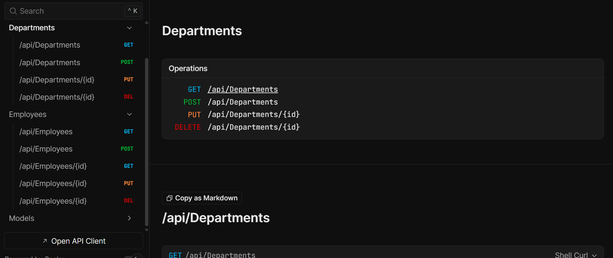

# Employee Admin Portal


[](https://github.com/yourusername/employee-admin-portal)
[](https://opensource.org/licenses/MIT)

A robust ASP.NET Core 8 Web API for efficient management of employee records using a SQL Server database.

## 🚀 Features

*   **RESTful Endpoints:** Full CRUD operations (Create, Read, Update, Delete) to manage employee data.
*   **Code-First Database Design:** Uses Entity Framework Core migrations to maintain database schema synchronization.
*   **Data Separation:** Implements Data Transfer Objects (DTOs) to decouple the external API contract from internal database entities.
*   **Interactive Documentation:** Integrated Swagger/OpenAPI support for easy testing and endpoint visualization.

## 🛠️ Installation

1.  **Prerequisites:**
    *   .NET 8 SDK
    *   Visual Studio 2022
2.  **Clone the repository:**
    ```bash
    git clone https://github.com/yourusername/employee-admin-portal.git
    ```
3.  **Configure Database:**
    *   Update the connection string in `appsettings.json` to point to your local SQL Server instance.
4.  **Apply Migrations:**
    *   Open the Package Manager Console in Visual Studio and run:
        ```powershell
        Update-Database
        ```
5.  **Run the Project:**
    *   Press F5 or use the `dotnet run` command.

## 📖 Usage

Once the application is running, navigate to the Swagger UI (usually `https://localhost:7xxx/swagger`) to interact with the API:

*   **GET** `/api/employees`: Retrieve a list of all employees.
*   **POST** `/api/employees`: Add a new employee by providing a JSON body.
*   **PUT** `/api/employees/{id}`: Update an existing employee's details.
*   **DELETE** `/api/employees/{id}`: Remove an employee record from the database.

## 🤝 Contributing

We welcome contributions! Please read our `CONTRIBUTING.md` guide to learn about our development process and pull request standards.

## 📜 License

This project is licensed under the MIT License. See the `LICENSE` file for more details.
